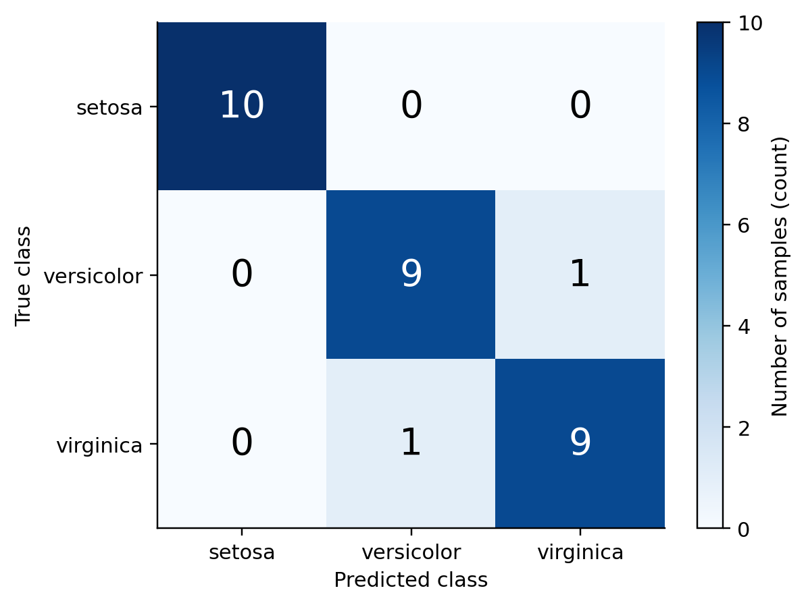

# 基于深度学习的鸢尾花识别分类

武汉工程大学《人工智能编程基础》综合设计，2025人工智能（机器人方向）01班。作者：郝雅蓉。

使用 TensorFlow 对花萼长度、花萼宽度、花瓣长度、花瓣宽度四项测量值分类，单位均为 **cm**。输出为 setosa、versicolor 或 virginica；输入数据为数值测量。

## 报告与下载

- [Word 报告](report/2508050230_郝雅蓉_综合设计报告.docx)
- [PDF 报告](report/2508050230_郝雅蓉_综合设计报告.pdf)
- [兼容 DOC 报告](report/2508050230_郝雅蓉_综合设计报告.doc)
- [发布版本与附件](https://github.com/hyris188/iris-deep-learning-design/releases/latest)

保留学校模板的封面信息、说明、课程目标、毕业要求、成绩评定表和前三项任务要求，完成中英文摘要、四章正文、总结、致谢、参考文献和代码附录。教师评分、签字及未提供的学业导师姓名留空。封面的起止日期是课程规定时间；本次实验实际执行于 **2026-11-22**。

## 实测结果

主模型为 4 → 16 → 8 → 3，隐藏层采用 ReLU，输出层采用 Softmax，共 243 个参数。

| 模型 | 测试准确率 | 宏平均 F1 |
| --- | ---: | ---: |
| 多数类基线 | 33.33% | 0.1667 |
| 逻辑回归 | 93.33% | 0.9333 |
| 两隐藏层 TensorFlow 网络 | 93.33% | 0.9333 |

训练、验证、测试分别为 90、30、30 条，按类别分层，划分种子为 42。标准化器只拟合训练数据；早停只监控验证损失。主模型结构预先确定，独立测试集不用于调参。



主模型共正确分类 28/30 条。两条错误分别发生在 versicolor 与 virginica 之间，其中一条错误预测的 Softmax 分数约 0.9760。Softmax 分数没有经过概率校准，不代表真实场景下的可靠度。测试准确率的 95% Wilson 区间约为 78.68%–98.15%。同划分下的逻辑回归达到相同分数，本实验没有证明深层网络更优。

## 安装与运行

已在 Python 3.10.12、Linux x86_64、CPU 环境验证。建议使用干净的 Python 3.10 虚拟环境。

```bash
python3 -m venv .venv
source .venv/bin/activate
pip install -r requirements-dev.txt
python -m pytest -q
python -m src.iris_classifier predict 5.1 3.5 1.4 0.2
```

预测可以直接使用仓库中的模型，不需要先重新训练。四项参数依次是花萼长、花萼宽、花瓣长、花瓣宽。程序拒绝非数值、非正数、NaN 和无穷；训练范围外输入或最大分数低于 0.8 时给出复核标记。这个提示规则无法筛出所有误判。

重新训练全部实验并生成图表：

```bash
python -m src.iris_classifier train
python scripts/make_figures.py
```

`train` 会更新 `artifacts/`，执行主模型、两项基线、两项仅验证集消融和五个初始化种子的验证实验。后两项不使用测试标签选模型。固定划分下五个种子的验证准确率均值为 92.67%，样本标准差为 1.49 个百分点。这不是交叉验证。

`requirements.txt` 固定主要运行依赖；`requirements-dev.txt` 增加文档生成与检查工具；`requirements-lock.txt` 记录本次完整安装版本。需要复刻完整环境时可使用 `pip install -r requirements-lock.txt`。跨硬件、不同框架版本可能存在数值差异，运行耗时也会变化。

## 重新生成报告

```bash
python scripts/build_report.py
/usr/bin/python3 scripts/export_report.py
```

第一条命令读取 `artifacts/` 和从模板提取的 `report/template_front_matter.json`，生成 DOCX；第二条使用 LibreOffice 更新真实目录页码，并导出 PDF 与 DOC。在 Ubuntu 上第二条需要 `libreoffice-writer`、`python3-uno`，并使用能够导入 `uno` 的系统 Python。仅生成报告时无需重新训练模型。

报告生成会检查四章正文不少于 5000 个汉字、中文摘要不少于 300 个汉字；统计不包括摘要、表格、图题、总结与附录。验证记录位于 `report/validation.json`。标题与正文按模板字号设置，章节另起页，图表按章编号，引用采用上标顺序编码。

## 成果结构

```text
data/                 UCI 原始 CSV 与数据署名
src/                  训练和预测程序
tests/                数据划分 输入契约 模型加载等检查
artifacts/            模型 预处理参数 指标 索引 逐条预测 日志
figures/              PNG 与 SVG 图表
scripts/              绘图 报告生成 文档导出
report/               DOCX DOC PDF 模板前置内容及字数统计
ci/                   可供持续集成使用的检查配置
```

`test_predictions.csv` 保留零基原始行号。数据摘要、环境和训练过程分别记录在 `metrics.json`、`environment.json`、`history.csv` 中。主模型保存文件约 28 KB；训练计时只覆盖 `fit` 调用，未测功率或碳排放。可持续发展讨论采用小模型、CPU、早停与工件复用等有证据的工程措施。

本版本的 10 项本地检查已通过。当前 GitHub 凭据缺少 `workflow` 写入权限，因此持续集成配置保存在 `ci/github-actions-tests.yml` 中，未启用 GitHub Actions；账号具备相应权限后可将其移入 `.github/workflows/`。

## 数据与引用

数据来自 [UCI Iris 官方页面](https://archive.ics.uci.edu/dataset/53/iris)，许可为 CC BY 4.0，详细署名和固定文件 SHA256 见 [ATTRIBUTION](data/ATTRIBUTION.txt)。数据保持下载时字节与行序。

实现依据 [TensorFlow 官方入门教程](https://www.tensorflow.org/tutorials/quickstart/beginner)、[Keras EarlyStopping 文档](https://keras.io/api/callbacks/early_stopping/)、[StandardScaler 文档](https://scikit-learn.org/1.7/modules/generated/sklearn.preprocessing.StandardScaler.html) 和 [Adam 原始论文](https://arxiv.org/abs/1412.6980)。完整参考文献及上标引用见报告。

材料准备使用了 AI 辅助，训练、评价与检查均已实际执行。第三方材料和许可范围见 [NOTICE](NOTICE.txt)。
